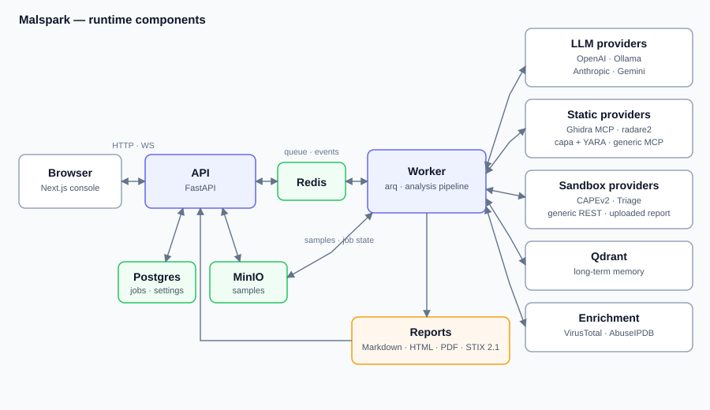

<p align="center">
  
</p>

<h1 align="center">Malspark</h1>
<p align="center"><em>AI agents that analyse malware end to end, with the evidence behind every claim</em></p>
<p align="center"><a href="https://malspark.com">malspark.com</a> · <a href="https://malspark.com/docs/">Documentation</a></p>

[](https://github.com/Root0ne/Malspark/actions/workflows/ci.yml)
[](https://github.com/Root0ne/Malspark/actions/workflows/codeql.yml)
[](https://scorecard.dev/viewer/?uri=github.com/Root0ne/Malspark)
[](https://www.python.org/)
[](LICENSE)

Upload a sample, and a team of AI agents analyses it from start to finish,
with no human in the loop:

1. **Code establishes the facts first.** A deterministic triage pack
   identifies the file, hashes it, checks its signature, runs the rule engines
   and decodes its strings.
2. **Analyst agents investigate with real tools:** a decompiler, a
   disassembler, a sandbox, capture readers, reputation services. Each agent
   decides what to call and when to stop.
3. **The analysts argue.** A mediator lists every contradiction between their
   claims, and the analysts it names revise with the evidence in front of them.
4. **A judge decides** the verdict, the family and the ATT&CK techniques, and
   drops what the evidence does not support.
5. **Every claim cites the evidence.** Each tool call is written to an evidence
   ledger with an id such as `ev_0021`, and every report section names the ids
   it rests on. The ledger is sealed when the run is stored.

The output is a report against MITRE ATT&CK (Markdown, HTML, PDF), a STIX 2.1
bundle, an IOC feed and detection drafts.

The organising rule is that **the agent decides and the code says what is wrong
with the decision.** Nothing rewrites a claim, a technique id or a confidence
behind an agent's back: a problem goes back to the agent with one turn to fix
it, and what it does not fix stays on the record.

Teams, tools, models and sandboxes are configuration. Any MCP server can give
the agents its tools, and a tool Malspark has never seen is used at full
strength. Nothing is bound to Windows: the sample's own bytes decide its route.

## Benchmark

The latest scored run: Claude Haiku 5.5 with the all-tools team on a
Latrodectus sample, with a real sandbox, scored against public human reports
of the family.

| Reference facts recovered | Wrong | Verified facts beyond the human reports | Cost |
| :-- | :-- | :-- | :-- |
| **55 of 57** (49 found, 6 partly) | **0** | **57** | **10.15 USD** (170 model calls, 94 minutes) |

The method, the per-group scores and what the run still gets wrong are on the
[benchmark page](https://malspark.com/docs/benchmark/).

## The teams that ship

| Team | Stages | For |
| :-- | :-- | :-- |
| `default` | `triage_pack` → `analysis` (static, dynamic, network) → `debate` → `verdict` → `report` | The general case: three analysts, with the pack in front of them. |
| `measurement` | The same four model stages, without the pack and with every tool server withheld | What the agents contribute on their own, with nothing to call. |
| `mobile` | `triage_pack` → `triage` → `android_static` → `dynamic` → `debate` → `verdict` → `report` | An APK or a DEX. The Android stage declines on anything else and says so. |
| `deep_static` | `triage_pack` → `triage` → `static` → `reversing` → `network` → `debate` → `verdict` → `report` | Reading the code: the reversing stage takes each static finding into the decompiler. |
| `team_lead` | `triage_pack` → `lead` → `verdict` → `report` | One lead agent plans, asks the specialists through `ask_<agent>` tools, and reports what they established. |

`triage_pack` is the deterministic pre-analysis pack, which runs no model; the
`triage` stage after it is the triage *agent*. A team of your own is written in
the console; the benchmark's all-tools team is
[an importable example](docs/examples/profiles/all-tools.json).

## Quick start

The compose stack is the supported way to run Malspark. It needs Docker with
the Compose plugin, Python 3.13 and [uv](https://astral.sh/uv/).

```bash
git clone https://github.com/Root0ne/Malspark.git && cd Malspark
make setup                          # dependencies, pre-commit, third-party trees
cp docker/.env.example docker/.env  # fill in every secret it declares
cp bootstrap.env.example bootstrap.env  # the same secrets, for make dev-up and make migrate
make dev-up                         # docker compose up -d, development overlay
```

Open <http://localhost:3000>, register the first account, promote it to
`admin` once in the database, then walk **Settings → Setup guides** to connect
a language model, a sandbox and the tools. The
[quick start](https://malspark.com/docs/getting-started/) has every command,
and [Deployment](https://malspark.com/docs/deployment/) covers production.

<p align="center">
  
</p>

## Documentation

The full documentation is at <https://malspark.com/docs/>. The pages live in
[apps/docs/content/docs/](apps/docs/content/docs/).

| Section | Pages |
| :-- | :-- |
| Introduction | [Overview](https://malspark.com/docs/), [Quick start](https://malspark.com/docs/getting-started/) |
| Concepts | [Pipeline](https://malspark.com/docs/concepts/pipeline/), [Agents and teams](https://malspark.com/docs/usage/teams/), [Evidence ledger](https://malspark.com/docs/concepts/ledger/), [Debate and judge](https://malspark.com/docs/concepts/debate-and-judge/), [Report](https://malspark.com/docs/concepts/report/), [Validation and feedback](https://malspark.com/docs/concepts/validation/) |
| Guides | [Running an analysis](https://malspark.com/docs/usage/running-an-analysis/), [Console](https://malspark.com/docs/console/), [Reports and exports](https://malspark.com/docs/usage/reports-and-exports/), [CI](https://malspark.com/docs/integrations/ci/) |
| Bring your own tools | [Overview](https://malspark.com/docs/tools/), [MCP servers](https://malspark.com/docs/integrations/mcp-servers/), [Sidecars](https://malspark.com/docs/tools/sidecars/), [Generic MCP servers](https://malspark.com/docs/tools/generic-mcp/) and the built-in tools |
| Models and sandboxes | [LLM providers](https://malspark.com/docs/providers/), [Sandboxes](https://malspark.com/docs/tools/sandboxes/) |
| Reference | [Configuration](https://malspark.com/docs/configuration/), [REST API](https://malspark.com/docs/api/), [CLI](https://malspark.com/docs/cli/), [Validation codes](https://malspark.com/docs/validation-codes/), [Security](https://malspark.com/docs/security/), [Architecture](https://malspark.com/docs/architecture/) |
| Operations | [Deployment](https://malspark.com/docs/deployment/), [Upgrades](https://malspark.com/docs/upgrades/), [Backups](https://malspark.com/docs/backups/), [Monitoring](https://malspark.com/docs/monitoring/), [Day-to-day operations](https://malspark.com/docs/operations/) |
| Development | [Development](https://malspark.com/docs/development/) |
| Benchmark | [The latest run](https://malspark.com/docs/benchmark/) |

Release notes are in [CHANGELOG.md](CHANGELOG.md).

## Licence

MIT — see [LICENSE](LICENSE). The third-party rule sets Malspark can use carry
their own licences and are not redistributed here; `make external` fetches
them, licence files included.
